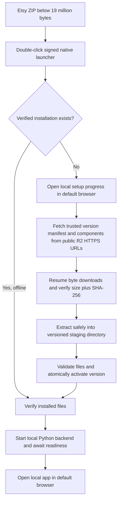

# Photo Relief Studio architecture decision — M1

Decision date: 2026-11-05 (Asia/Dubai). Scope: M1 feasibility and design, with
production installation deferred to M5. The upstream UI and processing algorithms
remain the application foundation.

## Selected distribution approach

Use a small Rust launcher, a loopback setup server, a browser setup page, and
platform-built Python 3.12 runtime/application/model components. This avoids
shipping a WebView shell or asking the customer to install developer tools.

The Rust proof compiles without Python and actually downloads, resumes, verifies,
extracts, starts a native test backend, and reopens it after its source server has
been shut down. The downloaded test backend explicitly identifies itself as a
demo; this does not claim that a relocatable full Python/PyTorch bundle is already
qualified. Genuine application inference is verified separately.

## What the M1 proof establishes

`bootstrapper/` uses reqwest with certificate verification/native root discovery,
tiny_http, serde, SHA-256 and ZIP extraction. The release binary statically links
the Windows C runtime. It serves real downloaded/total byte counts over loopback,
opens a browser using the OS opener, and launches an executable directly with an
argument array, never a downloaded shell command.

The proof requires a local manifest and its trusted SHA-256 on the developer
command line. It accepts HTTP only with an explicit test flag and only for
127.0.0.1. Normal component addresses must be HTTPS. Redirects are rejected. ZIP
traversal, links, oversized unpacked data, bad sizes/hashes and an untrusted
manifest are rejected. A later launch validates installed bytes against the
verified cached archives, rather than trusting a local “installed” marker.

Interrupted downloads preserve `.part` bytes and use Range on retry. If a server
ignores Range and returns 200, the proof restarts safely instead of appending a
second complete file. Final size/hash verification prevents corrupted bytes being
executed. Resuming across process interruption and corruption rejection are
executable tests. Extraction reports its genuine stage; per-file extraction
counters and resumable extraction are M5 work, not claimed by this proof.

The proof deliberately refuses an existing incomplete staging/version directory;
production recovery, rollback, cleanup, cancellation, multiple-instance handling,
automatic manifest discovery and customer-friendly errors are still M5 work.

## Runtime and component plan

Build the runtime on each supported OS/architecture using a pinned CPython 3.12
redistributable, locked compatible wheels, original app/static trees and complete
license notices. Do not distribute a developer virtualenv: its paths and scripts
can be non-relocatable. Prove installation on a clean machine without Python in M5.
[python-build-standalone](https://github.com/astral-sh/python-build-standalone)
provides a candidate redistributable Python source; the current uv-managed developer
Python already uses this family of builds, but that is not a clean-machine package test.

Start with separate Windows x64 CPU and macOS arm64 CPU/MPS packages. Add macOS
x86_64 only after native wheels/builds/tests qualify it. CUDA is an optional separate
Windows x64 component; its much larger torch stack must never replace the portable
CPU fallback without an explicit device decision. Windows ARM64 is unqualified.

Use separate immutable archives for runtime/libraries, application/static files,
DA2 Small model snapshot, optional DA2 Large and optional DA3 worker/weights. The
worker keeps numpy 1.26 separate from the main numpy 2 environment. It currently
supports CPython x64 Windows/Linux only; preserve DA3 as a capability and qualify
Mac support separately rather than pretending the existing dependencies support it.

Customer directories (no administrator access):

- Windows: `%LOCALAPPDATA%/PhotoReliefStudio/`, with versions, downloads, staging,
  models, sessions and logs beneath it.
- macOS: `~/Library/Application Support/PhotoReliefStudio/`, same logical layout.

The proof uses the platform directory resolver; exact organization/casing is a
prototype detail to normalize in M5. Runtime versions are immutable, while source
photos, params and model caches live outside version directories. Never move or
delete customer sessions during a version switch.

## Versioned manifest and R2

The shipping launcher should embed a public verification key plus a trusted
bootstrap release identifier. Fetch and validate a signed manifest over HTTPS,
then verify every component size/SHA-256 before extraction or execution. Hashes
fetched beside untrusted bytes are insufficient as an independent trust root.
The M1 developer proof models this with an externally pinned manifest hash.

The v1 example and JSON Schema in this directory include schema/release version,
platform, immutable HTTPS address, exact compressed size, unpacked size ceiling,
SHA-256 and executable/arguments. Example zero hashes/sizes are marked placeholders;
they are not installable releases. Production additionally needs a signed file
inventory, minimum launcher version, model revision/license, architecture/device
requirements, disk-space estimate and rollback metadata. This permits installed
file checks without keeping and rereading every compressed archive forever.

Publish components under immutable paths such as
`https://downloads.example.invalid/releases/1.0.0/windows-x86_64/runtime.zip`.
Use public read access through an R2 custom domain; upload credentials stay in the
release pipeline. No R2 account, access key, customer token, paid inference key or
private credential belongs in the launcher. No R2 account is needed for M1.

Keep `.part` keyed by trusted component digest. Add ETag/If-Range validation,
bounded retry/backoff and available-disk checks in M5. Show actual network bytes,
hash-verification stage and extracted file/byte counts. Do not invent progress
timers for opaque model or filesystem operations.

## Offline audit and provisioning

The frontend uses only relative API URLs and vendored three.js/addons/help images.
There are no runtime CDN scripts or web fonts. Upstream help links and attribution
links are optional navigation, not inference dependencies.

Network activity comes from first model loading and cache metadata checks through
Hugging Face/Transformers, its optional telemetry, installation/package indexes,
and any launcher update/download flow. The DA3 worker also loads model files from
Hugging Face. A depth-cache hit alone is insufficient proof of offline inference.

Before offline use, provision:

1. Python 3.12 interpreter, native DLL/shared-library dependencies, locked runtime
   wheels and complete app/static/help files.
2. DA2 model `config.json`, processor configuration, safetensors weights and a
   pinned snapshot/revision. Preserve cache refs/snapshot structure or load by a
   verified local snapshot path, not a mutable online branch.
3. For DA3, its isolated compatible runtime, worker, model config and weights.
4. Any extra selected model must be present before going offline; a missing optional
   model should produce a clear installed/not-installed explanation.

Set absolute `P2R_DATA_DIR` and `HF_HOME` before importing inference libraries.
Shipping launches should set `HF_HUB_OFFLINE=1`, `TRANSFORMERS_OFFLINE=1`,
`HF_HUB_DISABLE_TELEMETRY=1` and `DO_NOT_TRACK=1`. Use verified local model paths
and local-only loading, with no automatic online checks during ordinary startup.
[Hugging Face's cache documentation](https://huggingface.co/docs/huggingface_hub/en/guides/manage-cache)
explains why configuration/refs/snapshots matter alongside the weight blob.

M1 proved new DA2 Small inference with offline flags and an acceptance-only Python
socket guard rejecting connections outside loopback. This is stronger than replaying
cached depth, but is not an OS packet capture or a proof for every future dependency.

## Platform restrictions and solutions

| Platform | Current evidence and restrictions | Production route |
|---|---|---|
| Windows x64 CPU | Real app/exports on Windows 11; native bootstrap on Windows runner and local machine | Signed EXE, app-local redistributable runtime/DLL audit, no admin prerequisite |
| Windows NVIDIA | Adapter supports CUDA; no NVIDIA GPU on this laptop | Optional pinned cu128 package; test supported driver/VRAM matrix on real NVIDIA hardware |
| Windows AMD integrated GPU | This laptop's Radeon 610M is not CUDA | CPU fallback; do not advertise GPU acceleration here |
| macOS arm64 | Native CI CPU model and bootstrap proof executed on macOS 14 arm64 | Signed/notarized `.app` launcher and architecture-specific components; physical Mac browser/MPS test |
| macOS MPS | Main app selects it; no MPS GPU on hosted runner | Native PyTorch MPS path, CPU fallback for unsupported operations, test memory/performance separately |
| macOS x64 | Not executed | Dedicated x64 runner/package and clean Intel Mac acceptance before support claim |
| macOS DA3 | Worker project excludes macOS; no supported package route established | Separate dependency/adapter qualification; no silent model removal |

Apple distribution needs Developer ID signing, hardened runtime, notarization and
stapling, with nested native code signed in the correct order and a clean-machine
Gatekeeper test. Preserve executable mode bits in the ZIP. The measured M1 Mac
binary is an unsigned CLI proof, not a Finder-ready signed `.app` product.
See [Apple's distribution guidance](https://developer.apple.com/documentation/security/notarizing-macos-software-before-distribution).

[PyTorch MPS](https://docs.pytorch.org/docs/stable/notes/mps.html) is a separate
backend from CUDA. Docker on macOS does not provide the native app's MPS path.
Do not promise equivalent CPU, CUDA or MPS performance.

## Commercial license and attribution decision

The actual application LICENSE is **Apache-2.0**, despite the old README saying
MIT; M1 corrects that description and preserves LICENSE. Modified files identify
the M1 changes and upstream provenance is retained.

The current model cards list
[DA2 Small as Apache-2.0](https://huggingface.co/depth-anything/Depth-Anything-V2-Small-hf),
[DA3 Mono Large as Apache-2.0](https://huggingface.co/depth-anything/DA3MONO-LARGE),
and [DA2 Large as CC-BY-NC-4.0](https://huggingface.co/depth-anything/Depth-Anything-V2-Large-hf).
These are source listings checked in M1, not a legal clearance opinion. The old
project accepted noncommercial weights for personal use. That assumption does not
carry over to a commercial Etsy product. Keep the Large implementation in the
source/feature checklist, and resolve commercial permission or an explicitly
approved capability-preserving alternative before product distribution. In
particular, the current MPS default chooses that Large model.

## M5 acceptance gates still required

Clean Windows/Mac customer-machine install without Python/Git/Docker; signed
manifest and executable validation; corrupted/truncated/tampered downloads;
network loss/retry/cancel; power-loss-safe activation; disk exhaustion; offline
reopen and optional-model errors; single instance/reopen; lifecycle/shutdown;
port/readiness identity; runtime relocation; native DLL/Mach-O dependency audit;
uninstall preserving customer data; and signed ZIP sizes under 19,000,000 bytes.

The original API is unauthenticated. Production must remain loopback-only and add
Host/Origin checks and a per-launch session secret. The proof has no writable
setup HTTP endpoint. Replace its temporary port reservation with an actual child
readiness handshake and instance identifier before shipping, so an unrelated
listener cannot be mistaken for the application.
