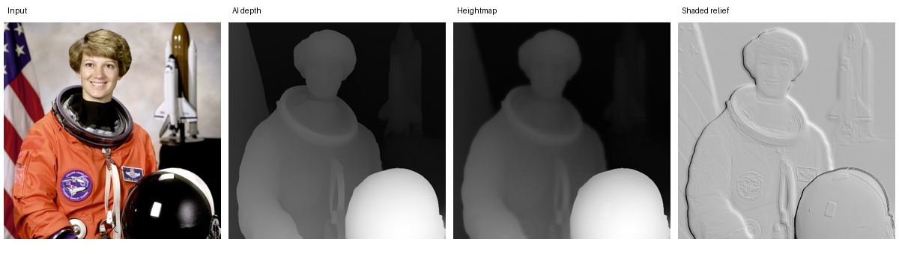
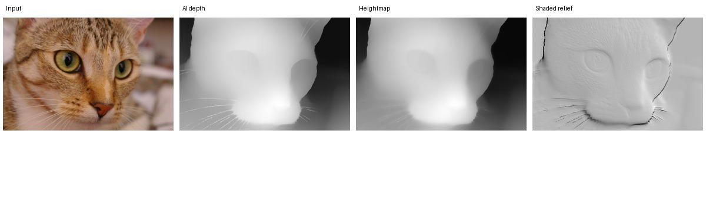
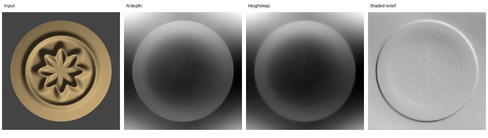
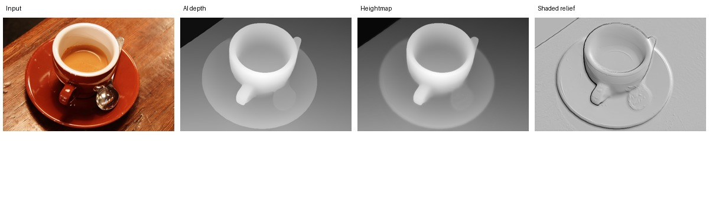
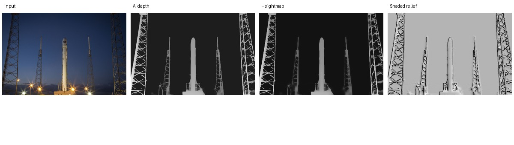
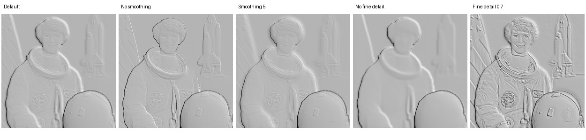
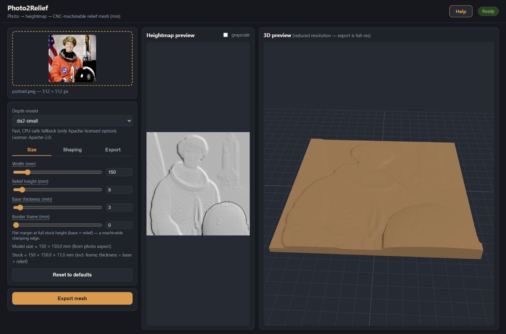

# Photo Relief Studio — M1 completion report

Completed 2026-11-05, Asia/Dubai. Scope: foundation, baseline verification and
architecture only. **M2 has not started.**

## A. Executive summary

**M1 result: qualified pass for the development foundation and packaging
feasibility.** The preserved application runs on Windows, processes real photos
locally using all three existing model choices, shows 2D/interactive 3D previews,
and exports closed STL/OBJ meshes that reopen successfully. A native bootstrapper
proof runs on Windows and Apple Silicon macOS, well below the Etsy ZIP limit.

This is not yet a customer release or a premium-relief quality approval. The
original UI remains in place. Two reproducible preview edge cases, low-memory
limits, untested accelerator configurations, commercial model licensing and the
complete production installer remain explicitly open.

Changes were kept focused:

- Preserved upstream Git history and the exact source baseline.
- Repaired the DA3 worker's Windows x64 dependency resolution. The original lock
  chose a Windows ARM torchvision wheel; the CPU extra now selects its compatible
  CPU build, with supported CPython x64 platforms stated explicitly.
- Fixed genuine DA3 CPU crashes by keeping CPU inference in float32. The pinned
  vendor API selected float16 on CPU using a CUDA-oriented precision policy. The
  same real sphere smoke test failed before this change and passes afterward.
  The original CUDA forward path remains intact.
- Added real HTTP acceptance/evidence tooling, focused geometry regression checks,
  process-tree memory sampling, native bootstrap source/tests, platform CI, a
  complete preserved-feature checklist, architecture and developer instructions.
- Corrected the README's application-license statement to match the preserved
  Apache-2.0 LICENSE. Added `psutil` as a development-only measurement dependency.

No core heightmap/meshing algorithm was changed, no feature was removed, and no
complete redesign or production installer was implemented.

## B. Repository baseline

- Destination: [thomastt-cryoo/carvyyy](https://github.com/thomastt-cryoo/carvyyy).
- Original: [PotatoVibes/photo2relief](https://github.com/PotatoVibes/photo2relief).
- Exact upstream commit: `8f7cd6d3fdba13c872b0747b42eeb1ba62ae1c64`,
  “Add Apache License 2.0”, 2026-08-09. Its history is retained, not copied into an
  unrelated new history. `main` holds that imported baseline and
  `codex/m1-foundation` contains M1; [PR #1](https://github.com/thomastt-cryoo/carvyyy/pull/1)
  collects the work for milestone review.
- Local development: Windows 11 Home 10.0.26300, AMD Ryzen 5 7520U (4 cores/8
  threads), Radeon 610M integrated graphics, about 13.7 GiB visible system RAM.
  There is no NVIDIA CUDA device. Python **3.12.16**, uv-managed `.venv`, locked
  CPU dependencies; system Python 3.14 was only used to invoke uv.
- Runtime versions include torch 2.9.1+cpu, transformers 5.14.1, numpy 2.5.1,
  trimesh 4.12.2. See [environment.json](evidence/environment.json) for all recorded
  versions and the exact downloaded model revisions.

The existing implementation was inspected: README/SPEC/CLAUDE, configuration,
model adapters/caches, heightmap pipeline, mesh construction/export, API schemas,
sessions/jobs, isolated worker, frontend/vendored assets/help, tests, Docker and CI.

The actual pipeline is photo validation/EXIF normalization → cached model-specific
depth (near=1) → clip/invert/gamma/background threshold/smooth/luminance detail →
resize/taper/frame → solid mesh → optional whole-solid simplification →
watertight gate → export. Frontend previews are a PNG and reduced GLB. Parameters
do not normally rerun AI inference.

Important findings: floor/ceiling operate on normalized values, despite some
upstream “percentile” wording; the border is at full stock height, rather than the
older SPEC's zero-height flange; current defaults differ from the older SPEC;
and stored sessions survive restarts while in-memory export job tracking does not.

Layout additions are `bootstrapper/`, `tools/m1/`, `docs/m1/`, the additional
geometry test, and M1 verification workflows. Follow
[DEVELOPMENT.md](DEVELOPMENT.md) to reproduce the tested environment.

## C. Functionality audit

The [full preserved-feature checklist](FEATURE_INVENTORY.md) covers all 18
parameter fields, all three models, input/session/cache behavior, previews,
export/progress, deployment and additional source-discovered features. It labels
real end-to-end verification, isolated unit verification and source-only items
separately.

Real end-to-end checks passed for upload, depth inference, grayscale/shaded PNG,
interactive GLB display, camera rotation/zoom, setting changes without regenerating
depth, saved-parameter resume, STL/OBJ generation/download and mesh reimport.
The browser downloaded a real 512 STL, with its triangle/size summary visible.
Observed browser console checks reported no warnings/errors during these flows.

Open defects and limits:

| ID | Finding and evidence | Consequence |
|---|---|---|
| M1-D01 | A 2000×2 image becomes a one-vertex short side at preview resolution; strict expected-failure test reproduces the failure | Very extreme aspect ratios need a deliberate geometry/preview policy |
| M1-D02 | A 10 mm image with a 50 mm frame becomes a 2816-side heightmap after a nominal 256 preview cap | Border padding can bypass preview/export resource limits; high settings can allocate enormous meshes |
| M1-D03 | A second 2048 reimport under memory pressure failed allocating a 577 MiB array | Need memory-aware export preflight and clearer low-memory handling; no blanket 2048 guarantee on a busy laptop |
| M1-D04 | Height is derived from the rounded grid ratio; e.g. pet input 451×300 at 512 exports 150×99.902 mm rather than the unrounded 99.778 mm | Overall width is exact; original-photo aspect/height and frame margins are subject to sampling quantization |
| M1-D05 | Sessions/cache/jobs have no automatic retention limit; jobs are memory-only | Disk usage and restart/recovery UX need a production policy |
| M1-D06 | Model registry advertises DA3 even where its worker cannot be installed, and Mac MPS defaults to noncommercial V2 Large | Availability needs platform-aware messaging and commercial model policy |

HEIC/WebP decoding and EXIF handling are preserved in source but were not accepted
with a real phone HEIC fixture. Docker is not installed in this host's command
environment and was inspected rather than executed. No fresh Docker/GHCR publish
or Autodesk Fusion/CAM acceptance is claimed.

## D. Visual and AI quality

Four openly available photographs came from scikit-image's versioned data, plus
one project-generated lit medallion fixture. The ornament is explicitly synthetic,
not represented as a real photograph. Origin, credits and SHA-256 hashes are in
[sources.json](evidence/inputs/sources.json); licensing descriptions are supported
by the [scikit-image data documentation](https://scikit-image.org/docs/stable/api/skimage.data.html).
All depth maps in the following comparisons came from genuine model execution.

| Subject | Observed baseline result and carving concern |
|---|---|
| Human portrait | Subject separates from the wall; the forward helmet becomes strongly raised with V2. Facial depth is shallow and much of the visible eye/mouth detail comes from luminance blending. Good silhouette, insufficient facial sculpting for a premium claim. |
| Cat/pet | Nose is nearer than background, face/ears stay recognizable. Eyes have weak sculptural definition; fur and whiskers can become shallow texture or sharp ridges. |
| Decorative medallion | The circular object is recognized, but modeled depth follows a broad lighting/tilt interpretation and loses much of the ornamental petal structure. A clear quality failure for faithful ornamental reconstruction. |
| Coffee cup/object | Rim, bowl and handle read convincingly; cup interior is recessed. Spoon and wood grain are shallow/texture-driven, with some unwanted background detail. |
| Complicated rocket scene | Rocket and towers separate from sky. Thin tower lattice creates steep, noisy geometry and competes with the subject. The current threshold control is not a semantic background mask. |

The portrait was also processed end to end with V2 Large and the repaired DA3
worker, with both formats exported and reimported. Their visual comparisons are
[V2 Large](evidence/portrait-da2-large-cpu-large/comparison.jpg) and
[DA3 Mono Large](evidence/portrait-da3mono-large-cpu-da3/comparison.jpg). DA3 uses a
different depth allocation across subject and helmet; it still does not establish
premium facial detail. These are relative-depth models, not reliable recovery of
true object dimensions from one photograph.

Surface comparisons were also generated from each subject's original, genuinely
inferred depth array: default settings, no smoothing, smoothing 5, no fine detail
and fine detail 0.7. On the portrait and cat, turning fine detail off removes most
eye/fur texture; increasing it adds recognizability but also brightness-derived
grooves and noise. Extra smoothing softens depth boundaries and whisker ridges,
but does not remove later-added luminance texture. It cannot recover the medallion
petals that the depth model missed. The cup's spoon and wood grain, and the
rocket scene's lattice, become much harsher at high detail blend. These are
visual observations, not a premium-quality score.

Other surface comparisons: [cat](evidence/pet-surface-comparison.jpg),
[ornament](evidence/ornament-surface-comparison.jpg),
[cup](evidence/object-surface-comparison.jpg),
[complex scene](evidence/complex-surface-comparison.jpg). Reproduce them with
`uv run --no-sync python -m tools.m1.compare_surface`; no new inference or fake
depth is used for these setting-only comparisons.

Actual 3D browser evidence:

Additional screenshots show [cat](evidence/browser-pet.jpg),
[ornament](evidence/browser-ornament.jpg), [cup](evidence/browser-object.jpg),
[complex scene](evidence/browser-complex.jpg),
[camera rotation/zoom](evidence/browser-portrait-orbit.jpg),
[saved settings](evidence/browser-settings-resumed.jpg) and
[successful browser export](evidence/browser-stl-export.jpg). Preview GLBs are
included beside the comparison PNGs. No physical carving or toolpath simulation
was performed; visual suitability remains a quality task for M2.

## E. STL/CNC verification

All five Small-model subjects produced STL and OBJ files at 512 resolution that
reopened with **watertight=true**, consistent winding and positive signed volume.
The Large/DA3 portrait round trips passed the same checks. The initial Small
portrait also exported/reimported successfully at 1024 and 2048.

Automated geometry checks prove outward base normals, flat Z=0 backing,
sidewall closure, positive volume, correct +Y image-top orientation, base/relief
scaling, flat maps, very wide/tall valid grids, successful STL/OBJ round trips and
an 80% triangle reduction that stays a closed outward solid with dimensions within
0.1 mm of the unsimplified surface. The original 512/1024/2048 watertight tests pass.

The default portrait's X/Y is 150×150 mm, bottom Z=0, top about 10.997 mm for
Small at 512. Its configured stock is 3 mm base plus up to 8 mm relief. Smoothing
and detail shaping can keep the maximum sample below one, so actual top Z need
not equal the full 11 mm stock; direct 0/1-map tests prove the height scale.

Frame outer dimensions/full stock height pass existing tests. Frame width is
sampled in pixels; sub-grid precision and exact original aspect are not guaranteed.
No claim is made that every physical dimension stays within 0.01 mm of the
unrounded source-photo aspect at every resolution. STL/OBJ imports must use **mm**.
The files were reopened with trimesh, not accepted in a commercial CAM package or
physically cut on a CNC machine in M1.

## F. Performance and resources

Measurements below are real wall times on the Ryzen laptop, four inference
threads, 512-ish input photos, CPU-only. They are exploratory measurements on a
shared interactive machine, with other setup/test workloads during parts of the
session. They are not a controlled hardware benchmark or a customer guarantee.
Upload includes HTTP transfer plus image normalization/persistence.

| Small-model case | Upload | Inference/load/cache-miss operation | Shaded PNG | GLB preview |
|---|---:|---:|---:|---:|
| Portrait | 0.211 s | 41.265 s, initial loading/download path | 0.388 s | 0.249 s |
| Cat | 0.246 s | 2.891 s | 0.237 s | 0.197 s |
| Ornament | 0.053 s | 3.437 s | 0.384 s | 0.362 s |
| Cup | 0.971 s | 38.047 s, substantial host/resource contention | 1.611 s | 0.702 s |
| Complex scene | 0.152 s | 2.297 s | 0.452 s | 0.413 s |

The separately restarted offline fresh-portrait run took **37.843 s** for genuine
Small-model inference/loading. V2 Large's initial portrait took **267.390 s**,
including its first checkpoint-download/load path, so this is not a warm-forward
timing. DA3's repaired CPU portrait took **58.969 s**, including isolated worker
startup/model load with weights already cached. No isolated warm Large-forward
benchmark was run. The pre-fix vendor DA3 portrait did complete once but its
roughly 190 s forward timing is superseded by the reliable float32 path.

Initial successful Small portrait exports, including job polling and excluding
client download/reimport:

| Grid | STL triangles | Export wall time | Exact STL bytes |
|---|---:|---:|---:|
| 512 | 528,374 | 1.543 s | 26,418,784 |
| 1024 | 2,105,334 | 3.380 s | 105,266,784 |
| 2048 | 8,404,982 | 21.742 s | 420,249,184 |

The 512 portrait OBJ was 21,417,856 bytes and exported in 2.684 s. The other 512
STLs were approximately 17.6–26.4 MB, depending on aspect. These customer-generated
mesh sizes are separate from the Etsy launcher ZIP limit.

Corrected sampled peak resident memory for the complete backend child-process
tree was about **1.01 GB** in the fresh offline Small run, **2.36 GB** in Large,
**3.28 GB** in the DA3 run, and **3.81 GB** during the later export stress run.
Client-side reimport also needs substantial additional memory; it failed that
later 2048 reimport requesting another 577 MiB. The initial 2048 round trip did
pass. An earlier sampler accidentally measured only Windows' tiny venv launcher
stub; its JSON is explicitly marked invalid and its 5 MB value must not be used.

No NVIDIA or Apple MPS timing/VRAM result was measured. The Mac CI tests used CPU.
Windows AMD integrated graphics do not provide the CUDA path. The host results
favor Small for this lower-powered CPU, and do not promise comparable speed across
CUDA, Apple Silicon GPU, or different CPU/RAM configurations.

## G. Packaging feasibility

Selected architecture: Rust native launcher + embedded loopback setup server +
default browser, with separately verified runtime/app/model downloads from R2.
See [ARCHITECTURE.md](ARCHITECTURE.md) for the platform matrix, offline audit,
trusted-manifest design, storage layout, licensing and production acceptance gates.

Measured release artifacts, ZIP containing native executable plus a short README:

| Executed target | Native executable | Measured ZIP | Limit result |
|---|---:|---:|---|
| Windows 11 x64, local build | 2,176,000 bytes | **1,149,120 bytes** | Below 19,000,000 and 20,000,000 |
| Windows Server x64, CI | 2,175,488 bytes | **1,147,752 bytes** | Below both limits |
| macOS 14 arm64, CI | 1,949,712 bytes | **1,089,225 bytes** | Below both limits |

These are measured unsigned engineering proofs. The final signed Windows ZIP and
notarized Mac `.app` ZIP have not been built or measured. There is ample prototype
size margin, but final artifact checks are still required in M5. A full desktop
WebView shell was unnecessary for the proven setup experience.

Each platform's native executable passed 14 acceptance checks: interrupted
download fails closed, partial preservation, successful retry, actual Range use,
genuine byte progress, ignored-Range restart, corrupt download rejection/no
installation, ZIP traversal rejection/no escape, trusted manifest pin rejection,
offline native-backend startup, corrupt installed executable rejection and ZIP
size. Two Rust unit tests cover unsafe paths and HTTPS/test-loopback policy.
Local Windows execution also opened the default Chrome browser automatically and
landed on the downloaded demo backend's clearly labeled page.

The proof backend is a native test program, not the full packaged Python product.
Full runtime relocation, clean-machine installation, signing/notarization,
single-instance lifecycle, readiness identity, update/rollback, disk-space checks,
cancel/extraction recovery and production R2 integration remain M5 work. No R2
credentials were requested, and no storage secrets/API tokens are embedded.

Ordinary launches should be offline by default after complete provisioning.
The fresh offline Small inference succeeded with external Python socket connects
blocked and offline flags enabled. The native proof reopened after its download
server was shut down. Mac CPU tests and native proof really executed in
[GitHub Actions](https://github.com/thomastt-cryoo/carvyyy/actions/runs/41905570906);
this is not inferred from cross-platform source. Mac browser/MPS, Intel Mac,
Windows ARM, GPU inference and the signed customer flow remain untested.

Commercial distribution is gated by model licensing: the model cards currently
list [V2 Large as CC-BY-NC-4.0](https://huggingface.co/depth-anything/Depth-Anything-V2-Large-hf),
while [Small](https://huggingface.co/depth-anything/Depth-Anything-V2-Small-hf) and
[DA3 Mono Large](https://huggingface.co/depth-anything/DA3MONO-LARGE) list Apache-2.0.
The Large capability remains preserved. Permission or an explicitly approved
capability-preserving alternative must be settled before commercial release,
including the current Mac default-model choice.

## H. Automated tests and verification record

| Executed check | Passed | Failed | Expected failures / deselection |
|---|---:|---:|---|
| Original Windows fast suite, unchanged upstream | 102 | 0 | 2 real-model tests deselected by upstream default |
| M1 Windows full fast suite | 115 | 0 | 2 strict expected failures for D01/D02; 2 slow tests deselected |
| Added geometry tests alone | 13 | 0 | Same 2 expected failures, not extra passing coverage |
| Real Small CPU smoke, Windows | 1 | 0 | None |
| Real DA3 CPU sphere smoke, final float32 worker | 1 | 0 | None |
| Original DA3 CPU attempts before precision fix | 0 | 1 per attempt, twice | Preserved as failure history; not counted as passing |
| Windows CI fast + real Small smoke | 115 + 1 | 0 | 2 expected fast failures; unrelated Mac-only step skipped |
| Apple Silicon macOS CI fast + real Small smoke | 115 + 1 | 0 | 2 expected fast failures; unrelated Windows-only step skipped |
| Rust unit tests, per CI platform | 2 | 0 | None |
| Native executable acceptance, each local/CI target | 14 checks | 0 | Demo backend deliberately identified as a demo |
| Ruff lint + formatting | Pass | 0 | No ignored new lint failures |

Heightmap and meshing modules reached **100% statement and branch coverage** in
the recorded coverage run. Pytest emitted one dependency deprecation warning about
Starlette/httpx; it did not affect test success. Expected failures are visible,
strict tests so that a future fix becomes an unexpected pass requiring checklist
maintenance. They are not silent skips or assertions that the defects are fixed.

Machine-readable evidence: [test summary](evidence/test-summary.json),
[five-subject HTTP run](evidence/results-online-da2-small.json),
[offline fresh inference](evidence/results-offline-da2-small-verified.json),
[Large run](evidence/results-online-da2-large-cpu-large.json),
[DA3 run](evidence/results-online-da3mono-large-cpu-da3.json),
[memory-stress failure](evidence/results-offline-da2-small-memory.json),
[local native proof](evidence/windows-bootstrap-local.json),
[Windows CI native proof](evidence/ci/windows-bootstrap.json), and
[Mac CI native proof](evidence/ci/macos-bootstrap.json). An early acceptance-runner
port collision and a missing import were corrected; their exploratory output is
not used as acceptance evidence. The invalid early offline result is labeled as
superseded in its JSON.

## I. Prioritized M2 recommendations and decisions

1. **Resolve the commercial model policy before choosing product defaults.**
   Retain V2 Large's existing implementation, while obtaining appropriate
   permission or approving a specific alternative that preserves its intended
   capability. This is the main owner decision; no code review is required.
2. **Improve subject separation and relief composition.** Add a local masking
   strategy with controllable foreground/background behavior; compare all three
   models on portraits, pets and ornaments. The medallion and tower scene are
   useful explicit failure fixtures.
3. **Improve sculptural detail.** Separate meaningful facial/animal features from
   luminance texture, reduce silhouette cliffs and noisy whisker/lattice ridges,
   and judge smoothing through before/after relief renders. Do not treat a
   brighter image-detail overlay as recovered 3D geometry.
4. **Fix D01/D02 and resource handling before larger default exports.** Preserve
   physical aspect independently of sampled grid shape, enforce frame-inclusive
   mesh budgets, estimate RAM/file size, and surface low-memory failures clearly.
   Keep watertightness and outward winding as export gates.
5. **Extend hardware and model qualification.** Run the reproducible DA3 CPU route,
   collect controlled cold/warm benchmarks, test real NVIDIA CUDA and native Mac
   MPS, and obtain real HEIC/EXIF and CAM-import acceptance. Preserve CPU fallback.

M2 should continue from this branch and checklist without deleting existing
features. The redesign, complete runtime packaging and production installation
remain in their later milestones. **Work stops here for milestone review.**
