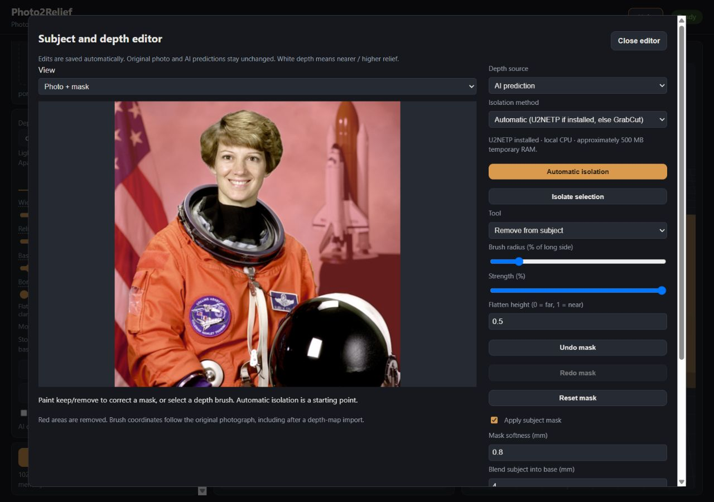
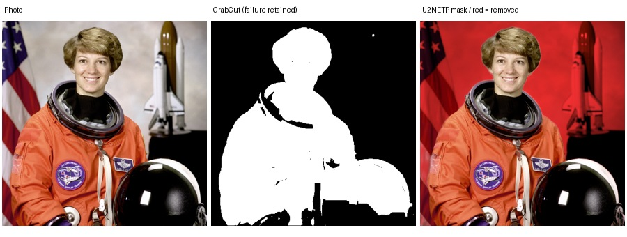
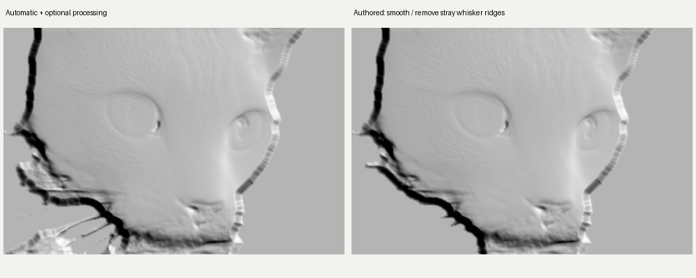

# Photo Relief Studio — M2 completion report

Date: 2026-11-05. Repository: [carvyyy](https://github.com/thomastt-cryoo/carvyyy).
Review: [M2 PR #2](https://github.com/thomastt-cryoo/carvyyy/pull/2), stacked on the
approved, still-unmerged [M1 PR #1](https://github.com/thomastt-cryoo/carvyyy/pull/1).
M2 began from clean M1 commit `dd9b08379510c2228cc4a4da2ce93ff0019a49cf`, rather
than the older upstream `main`. No M3 work was undertaken.

## A. Executive summary

**M2 passes functional and geometry acceptance, with explicit visual-quality
limitations.** The application now supports local subject isolation, reversible
mask/depth painting, high-precision depth exchange, saved histories, original/edited
comparison and safe resource planning. All 160 fast tests pass; a separate fresh
real-model editing/export smoke passes locally and on Windows/macOS CI. The original
three adapters, 18 parameters and export/preview workflows remain.

The useful demonstrated improvement is cleaner composition and controllable geometry.
This is not automatic realistic facial sculpture or faithful ornament reconstruction.
Small's original face depth remains shallow and its medallion prediction omits carved
petal geometry. Optional processing cannot restore missing information. These are
recorded limitations, with manual correction/import available as practical alternatives.

The new workflow is stable in the exercised cases. It has not received real CAM,
cutting, GPU or native Mac MPS acceptance. It is ready for M3 interface consolidation;
it is not a finished customer installer or a claim of production carving qualification.

## B. Preserved functionality

The [updated inventory](FEATURE_INVENTORY.md) maps all retained and added features.
All 18 `ReliefParams` remain, including gamma, clipping, inversion, bilateral/Gaussian
smoothing, photographic detail, background flattening, edge taper, dimensions, frame,
resolutions and simplification. PNG/shaded previews, the offline three.js GLB viewer,
STL and OBJ remain on one shared pipeline. Original photographs, per-model raw
predictions and previous imports remain available. The native M1 bootstrap prototype
and its two-platform workflow are preserved.

Intentional behavior changes: complete framed grids obey the requested resolution;
physical aspect no longer follows rounded grid aspect; overly extreme photos receive
a crop message; unsafe exports are refused before meshing; commercial MPS defaults
to Small. Two old assertions were updated because they encoded the old padding bug
and restricted Mac default. No original parameter or adapter was removed.

Commercial mode defaults on. V2 Large is still implemented and visibly listed but
requires separately obtained authorization or an explicit research configuration.
Unauthorized loading is blocked before weight download, and rejected parameter changes
leave the saved model unchanged. Small defaults on CPU/MPS; supported CUDA defaults
can use approved DA3. The model cards list [Small](https://huggingface.co/depth-anything/Depth-Anything-V2-Small-hf)
and [DA3 Mono](https://huggingface.co/depth-anything/DA3MONO-LARGE) as Apache-2.0,
and [V2 Large](https://huggingface.co/depth-anything/Depth-Anything-V2-Large-hf) as
CC-BY-NC-4.0. M2 creates no package containing restricted weights.

## C. Subject isolation

Built-in GrabCut was investigated and implemented with genuine-depth initialization
or a user-selected rectangle. It is color/graph segmentation, as described in
[OpenCV's documentation](https://docs.opencv.org/4.x/d8/d83/tutorial_py_grabcut.html),
not intelligent recognition from a threshold. It ran successfully but performed
poorly on these actual inputs: holes in the astronaut's black suit/helmet, missing
cat regions, a partial ornament arc, a missing spoon region, and the wrong rocket
background. Those [five failure records](evidence/sessions.json) and each subject's
`automatic-comparison.jpg` remain available.

The optional stronger method is local U2NETP salient-object segmentation, from the
[Apache-licensed U-2-Net project](https://github.com/xuebinqin/U-2-Net). Its
[published model reference/checksum](https://github.com/danielgatis/rembg/blob/main/rembg/sessions/u2netp.py)
matches the downloaded asset. The application additionally pins SHA-256, checks it
before execution and never downloads during editing. Automatic mode uses U2NETP
when installed, with an explicit GrabCut fallback otherwise. Keep/remove brushes,
rectangle isolation, independent history/reset, disable, feather and physical
subject-to-base transition remain available with both methods.

| Actual source | Result with optional U2NETP | Remaining correction/limitation |
|---|---|---|
| Human portrait | Astronaut and helmet separated from flag/shuttle | Fine suit-edge wisps; face geometry remains shallow |
| Cat | Much more complete face than GrabCut | Cropped ears cannot be restored; soft whisker remnants need cleanup |
| Coffee/object | Cup, saucer and spoon retained; table removed | Reflections are not reliable shape; minor boundary cleanup can help |
| Rocket/towers | Central rocket selected; distracting towers and lights removed | Surrounding towers deliberately excluded; not a full launch-complex reconstruction |
| Medallion fixture | Complete circular silhouette instead of GrabCut's arc | Interior petal anatomy is absent from original AI depth |

The isolated rocket is deliberately a narrow central subject; selecting the full
scene requires correction or disabling its mask. This is recorded as successful
central-subject isolation and unsuccessful automatic recovery of the entire scene.
Masking never deletes mesh faces: it blends heights into the continuous solid
backing. Default new-document transition is 4 mm and is adjustable. Very narrow
features can shrink under that transition; reducing it is a user tradeoff.

## D. Depth exchange and manual correction

PNG exchange is **16-bit grayscale**; optional NPY is lossless float32, loaded
without pickle. Tests verify more than 256 levels, PNG error at most 0.51/65535,
and exact NPY round trips. The browser-downloaded PNG's header independently confirms
16-bit grayscale. Eight-bit/RGB inputs, nonfinite/out-of-range arrays and oversized
NPY headers are rejected. Different resolutions with matching aspect resample;
aspect differences over 1% require explicit Stretch. This is not automatic registration.

White/higher means nearer/higher relief before the preserved optional inversion.
White-far import can explicitly flip orientation. Original import bytes and AI
arrays remain untouched, and saved import versions retain independent histories.
Imported depth uses the same preview and solid-export path as AI depth.

Raise, lower, smooth and flatten brushes have adjustable radius/strength and a flatten
level. Each gesture is one soft stroke, independent of pointer event density.
For linear depth, strength 0.1 at 8 mm relief gives a 0.8 mm center delta; later gamma,
filtering and mask blending can change that final delta. Undo/redo/reset, source
switching and reload persistence are tested. Edits do not rerun inference.

Durable state is a small atomic journal plus immutable masks/imports. Optimistic
revision checks prevent stale overwrites. Histories allow 500 gestures per layer
and a 4 MB journal cap; rejection preserves existing saved work. A full history
management/compaction experience belongs in M3. Original-AI comparison is view-only
and disables export until the edited view is restored.

The cat example includes a separate, **explicitly authored** smoothing/removal
demonstration. It removes stray whisker ridges without claiming recovered anatomy.
Working bytes after undo/redo match exactly, and the original AI hash remains unchanged.
[Stroke record](evidence/pet/authored-corrections.json).

## E. Sculptural quality and controlled visual evidence

Every comparison uses the same M1 source, Small model and original physical/shaping
settings: 150 mm content width, 8 mm relief, 3 mm backing, no frame, gamma 1.2,
smoothing 2.5 and detail blend 0.12. Genuine M1/M2 AI arrays were checked for exact
equality and their hashes rechecked after editing. No substitute or fabricated depth
was used. The medallion is the same procedurally lit M1 fixture, not a photograph.
Before views run the original shaping operations without M2 mask/quality edits
through the repaired physical sampler. They are not asserted to be byte-identical
historical M1 meshes; the historical [M1 evidence](../m1/REPORT.md) remains intact.

The fixed automatic evaluation uses U2NETP, 0.8 mm feather, 4 mm transition,
sculptural smoothing 0.45 and texture restraint 0.8. Both quality amounts default
to zero in the product. They bound narrow depth residuals and luminance grooves;
they complement the original controls and do not invent missing anatomy.

| Subject / full sheet | Visible benefit | Defects and limits |
|---|---|---|
| [Portrait](evidence/portrait/comparison.jpg) | Shuttle/flag background removed; continuous silhouette blend | Nose/eyes/lips still weak in genuine depth. Photo-derived marks are not anatomy |
| [Cat](evidence/pet/comparison.jpg) | Background removed; fine surface contribution restrained | Whisker-mask ridges remain automatically; authored cleanup above improves them |
| [Medallion](evidence/ornament/comparison.jpg) | Clean circular composition and outer transition | Automatic petals remain missing; restraint reduces some brightness-only petal lines. No claim of interior reconstruction improvement |
| [Coffee](evidence/object/comparison.jpg) | Table/shadow geometry removed; bowl/handle retained | Spoon reflections and apparent coffee/rim shape still unreliable |
| [Rocket](evidence/complex/comparison.jpg) | Dense false tower/lamp ridges removed from central composition | Rocket remains shallow, thin and simplified; full tower scene not recovered |

Each folder contains original AI float/PNG16, processed depth display, before/after
shaded PNGs, actual before/after GLBs, browser screenshots showing both previews,
settings, journal and immutable-mask archive. A black/white depth display is not a
quality score. Lower texture is sometimes smoother but less detailed: the ornament
is the explicit unsuccessful automatic detail-recovery case. Disable the optional
controls, author corrections or import a carefully prepared map when that tradeoff
is unsuitable.

3D evidence: [portrait before](evidence/portrait/browser-before.jpg)/[after](evidence/portrait/browser-after.jpg),
[cat before](evidence/pet/browser-before.jpg)/[after](evidence/pet/browser-after.jpg),
[medallion before](evidence/ornament/browser-before.jpg)/[after](evidence/ornament/browser-after.jpg),
[coffee before](evidence/object/browser-before.jpg)/[after](evidence/object/browser-after.jpg),
[rocket before](evidence/complex/browser-before.jpg)/[after](evidence/complex/browser-after.jpg).
Each corresponding `before.glb` and `after.glb` is the actual reduced solid preview.

## F. Geometry, resources and CNC export

| M1 defect | M2 result and evidence |
|---|---|
| D01 extreme aspect | Passing regression; minimum two vertices on thin grids; uploads beyond 64:1 reject with crop guidance |
| D02 frame bypass | Passing regression; complete frame-inclusive grid obeys cap; exact frame boundaries retained. A 256-square preview has at most 133,110 triangles |
| D03 memory failures | Grid/faces/bytes/RAM preflight before queue/construction, repeated at job start; configurable budget and friendly refusal |
| D04 dimensions/aspect | Source dimensions independent of sample rounding; asymmetric/frame regressions and actual STL/OBJ bounds pass |
| D05 storage growth | Safe quota/age duplicate-cache cleanup, dry-run by default; active leases and all user documents protected. Full session-management UX remains later |

All five edited 512 STL and OBJ files reimported with finite vertices, positive
volume, consistent winding, flat bottom at Z=0 and watertight solids. Masking created
no holes or disconnected floating solids. Physical XY bounds include 150 × 150 mm
for portrait/ornament, 150 × 99.77827 mm for the 451×300 cat, 150 × 100 mm for coffee,
and 150 × 100.078125 mm for the 640×427 rocket. Frame tests also verify 113 mm content
plus two 7 mm margins equals 127 mm, with exact boundary coordinates.

Browser STL download reimport: 528,374 triangles, watertight. A **55% simplified
OBJ** reimport: 237,768 triangles, watertight/consistent/finite, XY within micrometres
of 150 mm. Its height stays within the configured 11 mm stock. Separate export files
and immutable snapshots prevent subsequent changes replacing an earlier download.
[Actual download hashes/bounds](evidence/browser-downloads.json).

512, 1024 and 2048 remain selectable. The laptop's 1536 MB configured budget refused
a 2048-square request estimating 3911 MB before allocation; no deliberate OOM test
was performed. Decimation reduces the file but still constructs the full grid.
Memory estimates are conservative guidance, not a guarantee against every OS/library
allocation failure. No registered Fusion/Vectric/Carveco/FreeCAD/MeshCAM installation
was found in the local application registry check. **Real CAM import, tool accessibility,
toolpaths and physical cutting are unverified.** No G-code/CAM engine was added.

## G. Measured performance and footprint

Windows 11 Ryzen 5 7520U, 8 logical threads, approximately 13.7 GiB visible RAM;
four CPU threads configured. Final HTTP measurements use cached genuine depth,
with no concurrent test run. RSS sampled every 20 ms from the actual server process;
browser/client RAM and GPU memory are excluded. Values are individual observations,
not statistically repeated benchmarks or worst-case guarantees.

| Subject | U2NETP request s | Original → new shaded preview s | Original → new GLB s | Edited STL / OBJ 512 s |
|---|---:|---:|---:|---:|
| Portrait | 0.768 | 0.299 → 0.386 | 0.217 → 0.413 | 1.629 / 2.244 |
| Cat | 0.807 | 0.144 → 0.202 | 0.056 → 0.121 | 0.839 / 1.488 |
| Medallion | 0.951 | 0.314 → 0.414 | 0.212 → 0.368 | 1.561 / 3.073 |
| Coffee | 1.049 | 0.305 → 0.404 | 0.236 → 0.407 | 1.233 / 1.667 |
| Rocket | 0.957 | 0.212 → 0.403 | 0.191 → 0.367 | 1.673 / 1.768 |

[Full timings, memory samples, hashes and export plans](evidence/final-results.json).
Edited export server peaks were approximately 485–694 MiB. Segmentation requests
peaked at approximately 560–777 MiB total server RSS, adding 55–199 MiB over each
baseline in the adopted short-lived-session implementation. Cached depth avoided
repeated heavy inference; this does not measure a worst-case resident depth-model
plus segmentation plus concurrent export workload.

Before adoption, the independent retained-session U2NETP trial measured 0.38–0.52 s
inference, 0.19 s load and 499 MiB additional peak RSS. Short-lived ORT sessions with
CPU arena/memory-pattern retention disabled trade some load time for lower retained
memory. GrabCut requests took 1.65–5.46 s here and produced the recorded poor masks.
[Trial data](evidence/segmentation-trial.json).

Optional weights: **4,574,861 bytes**, SHA-256
`309c8469258dda742793dce0ebea8e6dd393174f89934733ecc8b14c76f4ddd8`.
The ORT wheel downloaded about 14.2 MiB on this host; installed ONNX Runtime,
flatbuffers and protobuf occupy about 43.4 MiB, plus 4.4 MiB weights, excluding
existing Python/depth dependencies. [Measured footprint](evidence/segmentation-footprint.json).
Fresh local real-model smoke took 67.08 s total including loading, new inference,
segmentation and both exports; this is not a pure inference benchmark.

## H. Tests and platform evidence

| Executed check | Pass | Fail | Skip / expected failure / deselection |
|---|---:|---:|---|
| Local full original + M1 + M2 fast suite | 160 | 0 | 0 skipped, 0 xfail; 3 real-model tests deselected |
| Local fresh Small/U2NETP editing/export smoke | 1 | 0 | 0 |
| M2 Windows CI fast / genuine smoke | 160 / 1 | 0 | 3 slow deselected in fast run; no smoke skip |
| M2 macOS 14 CI fast / genuine smoke | 160 / 1 | 0 | Same |
| Preserved M1 workflow on Windows/macOS | Pass both | 0 | Fast suite, real Small, native Rust tests and executable proof; opposite-platform step skipped |
| Ubuntu CI lint, format and fast tests | Pass | 0 | Model tests excluded by default |
| Browser functional acceptance | Pass | 0 | No console errors observed |

Windows M2 CI fast/smoke took 23.82/12.70 s; macOS took 34.91/16.44 s. These are real
CPU executions, not code-only platform analysis. [M2 Actions run](https://github.com/thomastt-cryoo/carvyyy/actions/runs/41948990174)
and [saved job record](evidence/ci-m2-jobs.json). Runtime/backend commit is
[0e03da6](https://github.com/thomastt-cryoo/carvyyy/commit/0e03da667ecace2ad78748fb4e03ff49f0a6ce7e),
functional UI commit [24d399d](https://github.com/thomastt-cryoo/carvyyy/commit/24d399d270ddc37de9be43986350362b43ee32c6).
Later documentation/evidence commits do not change that runtime code.

The preserved [M1 two-platform workflow](https://github.com/thomastt-cryoo/carvyyy/actions/runs/41948990140)
also reruns original Small and the native bootstrap proof for this change. Its
final status is recorded in `evidence/ci-m1-jobs.json`. Actual Mac MPS/CUDA and DA3
accelerator tests remain unexecuted; M1's original CPU DA3 evidence is preserved.

Browser acceptance exercised upload, automatic/rectangle isolation, keep/remove,
all four depth tools, undo/redo/reset, PNG16 import/download, source switching,
reload, five original/edited 2D+3D pairs, 2048 refusal and STL/simplified OBJ downloads.
Desktop and 702-pixel narrow editor layouts had no horizontal overflow in the checked
state. [Browser record](evidence/browser-verification.json),
[resource refusal](evidence/browser-resource-guard.jpg), [export](evidence/browser-export.jpg).
Local counts are in [local-tests.json](evidence/local-tests.json). Ruff lint/format
and both JavaScript syntax checks pass. One existing Starlette/httpx deprecation
warning remains; it does not fail these tests. No failing/xfail defect was hidden.

## I. Remaining issues and limitations

1. Missing facial anatomy, carved petals, accurate reflections and tower lattice
   are not solved. The ornament uniform-processing trial is an explicit quality
   limitation; controls are opt-in and the original remains available.
2. Fine/cropped/multiple subjects need manual correction. Transition width can
   consume narrow structures. Masks may need touch-up; no invisible semantic
   confidence or universal success claim is presented.
3. Session documents and edited work deliberately are not automatically deleted.
   They can still grow. M3 needs a document library, explicit retention/recovery,
   disk usage, history compaction and better long-session affordances. At a mask
   history/journal limit, preserve the session and begin a new document; depth
   export/reimport alone does not compact mask history.
4. Resource planning cannot reserve RAM or guarantee every large export. Whole-solid
   simplification can shift bounds by tiny tolerances; required watertight validation
   still gates output. Detailed CAM/material/tool acceptance remains outstanding.
5. Native packaging, signed production installers, real GPU/MPS, expanded camera
   EXIF/HEIC fixtures and macOS DA3 support remain later work. Model rights and asset
   licenses must be rechecked for actual distributions. Environment authorization
   flags do not themselves grant model rights.

## J. M3 readiness

The backend is ready for a focused new interface: durable versioned documents,
reversible tools, source selection, original comparison, model-policy metadata,
resource plans and a shared validated export pipeline are in place. Functional
controls intentionally retain the existing visual design. M3 should make these
capabilities easier for beginners while preserving the advanced surface.

Read [FEATURE_INVENTORY.md](FEATURE_INVENTORY.md), [ARCHITECTURE.md](ARCHITECTURE.md)
and [DEVELOPMENT.md](DEVELOPMENT.md) before interface work. The one-process journal
lock design, exact physical/grid separation and protected-document cleanup policy
must remain explicit architectural constraints. **Work stops at M2 for review.**
