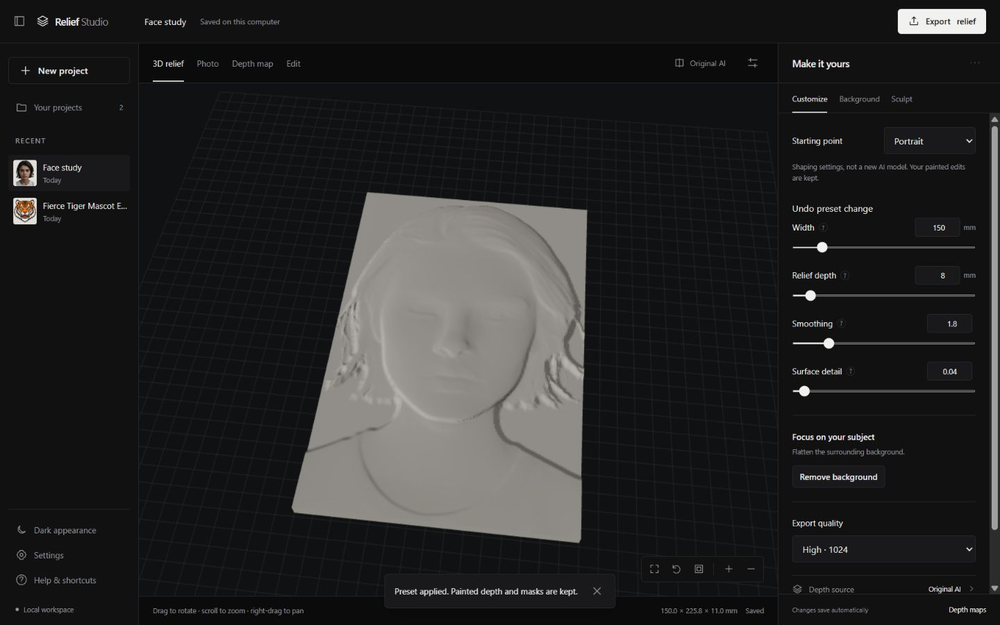

# Photo Relief Studio — M3 status report

2026-11-05. Branch `codex/m3-modern-workspace`, based on approved M2
`d34392d29a5970faf051b1a0126249dcf8455508`. M1/M2 source, tests, launcher prototype
and historical evidence remain. New examples use the supplied tiger and face only.

## A. Executive summary

**Implemented; final M3 acceptance pending.** The interface is comprehensively
redesigned around a dark/black workspace, project rail, prominent switchable canvas
and grouped customization. Local verification passes 181 Python tests, seven frontend
state tests and a genuine tiger project/export smoke. Both new examples pass actual
HTTP editing/import/export integration with original AI unchanged.

Actual browser work covered uploads, naming, presets, painting, comparison, advanced
fields and eight size/theme captures. Browser Use then failed with “Local browser
use is disabled in Work settings.” The owner's screenshot shows that setting On.
This client/tool mismatch is unresolved; no restriction was bypassed. Remaining
dialogs/downloads/recovery/offline acceptance and final screenshots must be finished.
**M3 is not yet fully passed. No M4 work has started.**

## B. UI implementation

Buildless HTML/CSS/ES modules and the existing local three.js avoid a new runtime
dependency stack. System fonts and local SVGs work without CDNs or analytics.
Dark is the owner's requested default; light uses the same tokens. Theme selection
is persisted before first paint. Native dialogs, focus outlines and keyboard paths
provide predictable interaction. No gradients, glass effects or emoji controls.

The three regions are a compact project rail, one 3D/Photo/Depth/Edit canvas, and a
scrollable Customize/Background/Sculpt inspector. The old cramped dual previews are
replaced. Fit/reset/top/zoom controls are included. Camera and aligned 2D painting
are separate surfaces. [Architecture](ARCHITECTURE.md).

## C. Beginner experience

Welcome provides upload/drop guidance and three concise steps. First generation
automatically chooses an installed, supported, permitted model. Missing models are
disabled; import-only projects remain possible without a download. Complete setup
installation stays outside M3. Progress distinguishes depth estimation, preview
rebuild and actual backend export stages without fabricated ETAs.

Portrait/Pet/Object/Ornament presets transparently configure gamma, smoothing,
detail blend and M2 surface refinement. They preserve dimensions, model/source and
painted depth/masks; preset Undo restores affected settings. Custom retains values.
Presets do not reconstruct missing anatomy or invoke missing models. Background
isolation remains an explicit action, so a preset cannot replace manual masking.

## D. Feature preservation

[The full matrix](FEATURE_INVENTORY.md) maps all 18 original fields and M2 tools
to locations and actual verification. Essential fields are immediate; Advanced
retains exact numeric geometry/depth/surface/model settings. Full original parameter
ranges remain, including the backend's 0–1 flatten threshold. Original adapters,
offline cache, shaded/grayscale previews, GLB, STL/OBJ and mesh gates remain.

Background supports auto/rectangle/keep/remove, feather/transition, disable/reset,
method selection and mask histories. Sculpt provides four brushes, size/strength/
level, separate histories/reset/shortcuts. Depth maps preserves PNG16/float32,
orientation/alignment, imported versions and original AI restoration. Comparison
is read-only across fields, imports, checkpoints, painting and export. Browser
execution observed import/source controls disabled while comparing.

Browser acceptance caught active-model reselection leaving Export disabled. That
was fixed and covered by a frontend test; final browser retest is pending.

## E. Projects and persistence

Existing session directories gain small atomic project metadata for names, dates
and preset undo. Recent/library/open/new/rename/last-project resume are implemented.
Queued/debounced writes flush before switching; scope generations prevent stale
responses replacing a later project, even after returning to the same ID. M2 revision
checks remain. Failed writes expose retry/reload instead of silently dropping work.

Deletion confirms and moves only a validated project to local recoverable storage.
Active inference/export/leases prevent moving busy work. Recently deleted restores
projects after reopening; shared models/cache and other work remain protected.
No permanent purge exists, so recovery copies continue using disk.

Metadata repair handles malformed syntax and wrong JSON shapes, backs up old files,
and preserves source/depth. Missing/damaged originals get recovery advice. Explicit
checkpoints retain exact current mask/depth and archive earlier state. Restoring
archives current work first. The dialog explains starting a new undo history.
Original photographs and AI arrays remain immutable; archives are never pruned
automatically. These flows pass API/unit tests; new browser dialogs remain pending.

## F. Export

The dialog exposes dimensions, STL/OBJ, Standard/High/Maximum quality mapped exactly
to 512/1024/2048, plus exact resolution and decimation. It uses the real M2 resource
plan and never silently lowers quality. Completion provides an explicit download.
Closing a dialog does not pretend to cancel a running backend export. Snapshots and
watertight gates are unchanged.

| Genuine edited input | STL faces | OBJ faces, 15% reduction | XY, mm | Reimport |
|---|---:|---:|---|---|
| Tiger | 528,374 | 449,116 | 150 × 150 | Watertight, finite, consistent winding, positive volume |
| Face | 351,558 | 298,824 | 150 × 225.82418 | Same, flat bottom at Z=0 |

Heights stay within 11 mm stock. Both 2048 plans were refused before meshing under
the configured laptop budget. Masks created no mesh holes. Large solids remain in
ignored `data/m3/exports`; [integration JSON](evidence/integration-results.json)
records hashes/bounds. New dialog downloads still require browser tests. Real CAM,
cutting and GPU/MPS remain unverified. No G-code/CAM engine was added.

## G. Actual screenshots

- Welcome: [dark](evidence/welcome-dark.jpg), [light](evidence/welcome-light.jpg).
- Portrait/3D: [face](evidence/workspace-face-dark.jpg).
- Background: [tools](evidence/background-tools.jpg).
- Manual depth: [painting](evidence/depth-painting.jpg).
- Comparison: [original](evidence/comparison-original.jpg), [edited](evidence/comparison-edited.jpg).
- Narrow desktop: [1024 dark](evidence/workspace-dark-1024.jpg), [1024 light](evidence/workspace-light-1024.jpg).
- All requested sizes/themes: [matrix](evidence/responsive-checks.json); corresponding
  `workspace-{dark|light}-{1920|1440|1366|1024}.jpg` files are present.

These are actual earlier captures, not mockups or final acceptance claims. Tiger
was uploaded/rendered; its final screenshot remains to capture. Its [source](evidence/inputs/tiger.png)
and [real GLB](evidence/tiger-edited.glb) are present. Advanced/Export/library/checkpoint
dialog screenshots also remain pending. No astronaut substitute is used.

Initial 768-height inspector spacing required scrolling to export quality. Compact
spacing was added and observed to place it inside the 1366×768 panel. Initial 3D
lighting was reduced/tone-mapped. Final recapture of all eight states is pending.
The initial matrix shows no horizontal overflow in either theme at all four sizes.

## H. Verification

| Actual local check | Passed | Failed | Other |
|---|---:|---:|---|
| Original/M1/M2/M3 fast regressions | 181 | 0 | 0 skip/xfail, 4 slow deselected |
| Frontend state/ranges/models/queue/presets | 7 | 0 | Node built-in runner |
| Genuine fresh tiger project/checkpoint/export smoke | 1 | 0 | Real Small inference, no fabricated depth |
| Tiger/face HTTP integration | 2 cases | 0 | All brushes, exact undo/redo, exchange, sources, exports |
| Browser acceptance | Partial | Caught readiness bug fixed | Remaining work blocked by app/tool state mismatch |

[Local counts](evidence/local-tests.json). Ruff lint/format and JS syntax pass.
The existing Starlette/httpx warning remains. Synthetic arrays test isolated math
only; both acceptance sources use genuine raw predictions. PNG16 maximum exchange
error was 7.66e-6; NPY stays float32. Original AI hashes were unchanged after editing.

Completed browser flows: tiger/face upload and real generation; project rename;
Portrait preset; remove/undo and raise; original comparison; comparison-disabled
imports; advanced field access and exact saving; theme switching; initial size matrix.
No console errors were observed in those successful checks.

Pending browser flows: remaining tools/shortcuts, photo/depth views, camera buttons,
all new dialogs, project switching/recovery/delete/restore/checkpoints, imports and
downloads, resource/failure/retry, restart persistence, explicit offline network trace,
and final screenshot matrix. API tests do not replace these.

The M3 Windows/macOS workflow runs fast tests, frontend rules and a genuine tiger
smoke. Results must be read from the draft PR's actual checks; this report does not
invent cross-platform outcomes. Original M1/M2 workflows are preserved.

## I. Performance

Ryzen 5 7520U Windows laptop, four CPU threads. Genuine first tiger inference took
21.672 s; face took 6.562 s with model warm. Offline HF loading was enabled. Cached
edited shaded/GLB requests measured .653/.626 s tiger and .582/.522 s face.
Edited STL/OBJ export measured 2.238/3.944 s tiger and 1.106/2.473 s face. Server
RSS peaks were about 500–795 MiB for exports, sampled every 20 ms. These are individual
observations, excluding browser/GPU and worst-case resident-model concurrency.

New HTML/CSS/JS is about 134 KiB uncompressed plus existing three.js; zero runtime
npm dependencies. [Footprint](evidence/frontend-footprint.json). Browser JS heap and
repeated camera responsiveness remain unmeasured. Full-suite/smoke timings overlapped
developer work and are not pure inference benchmarks.

## J. M4 readiness

**M4 is not started or approved by this report.** Restore browser access, complete
the pending H checklist, capture all required final screens and resolve any findings.
Keep the PR draft until that acceptance finishes. The owner already showed Local
browser use On; repeated searching for another guessed setting is inappropriate.
A desktop app/tool reconnection may be needed.

Preserve existing monocular quality limits: faces/ornament/reflections are estimates;
the tiger is emblem artwork, not a natural pet portrait. M3 does not claim a new
reconstruction algorithm. Signed production installers, permanent storage purge,
GPU/MPS and real CAM qualification remain later work. See [architecture](ARCHITECTURE.md),
[feature matrix](FEATURE_INVENTORY.md), and [developer route](DEVELOPMENT.md).
